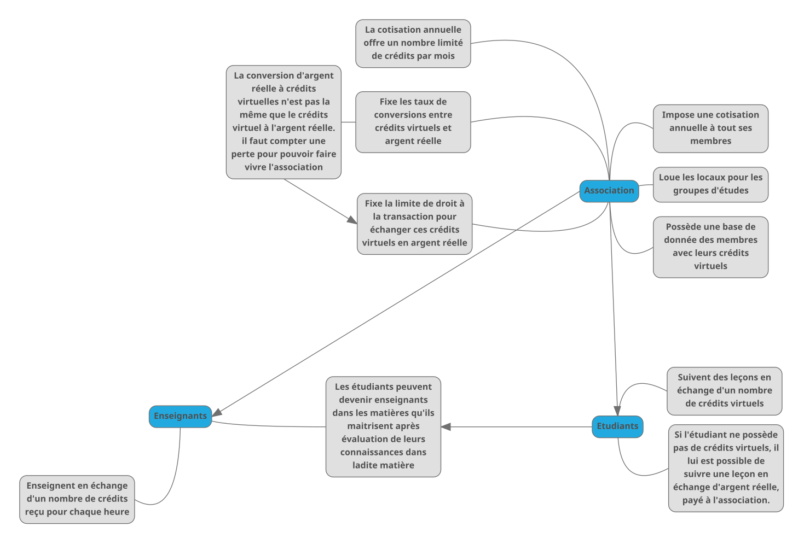
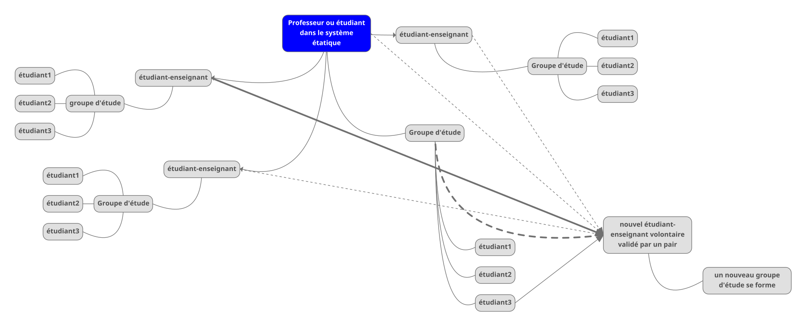
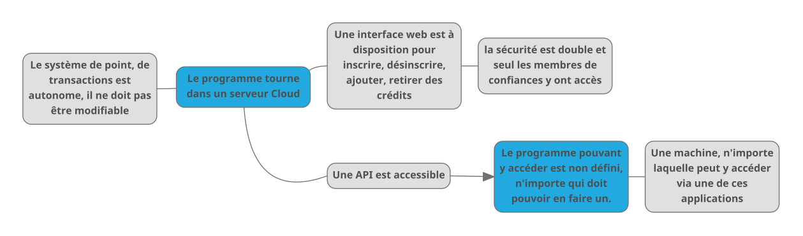

# EducationLibre
 Projet d'un système d'éducation accessible et libre `En cours de développement...`

Un système d'éducation adaptatif, évolutif et accessible. Inspiré du modèle [BitTorrent](https://fr.wikipedia.org/wiki/BitTorrent).

# Important
- Ce projet n'est d'aucune idéologie propre, il a pour but d'être un patch, un sous-système fonctionnant en parallèle d'un autre.

# Préface
    Cette idée n'est qu'utopique pour le moment, n'ayant émergé que depuis peu dans mon ésprit. 
    
    Libre à toute personne souhaitant la mettre en place d'utiliser ce repo GitHub afin de la déployer. 

    Je suis accessible depuis mon site web dans contact: https://nadnone.ch

    Ce système est initialement pensé pour une association

# Tout d'abord, pourquoi ?
- [Ici vous trouverez une explication de mon raisonnement personnel](./POURQUOI.md)

# Introduction
 - [En annexe depuis ici](./INTRODUCTION.md)

# Comment ?
L'idée de ce système est le même que `BitTorrent`, imaginons une discipline. supposons que je souhaites étudier la trigonométrie mais que je ne connaisse absolument rien de cette discipline. Un professeur diplomé membre de l'association ou de la personne morale n'est pas disponible pour pouvoir m'apprendre cette discipline, mais il se trouve que d'autres étudiant savent cette discipline. L'un d'eux a le temps de me l'enseigner. d'autres étudiants veulent apprendre cettre branche des mathématiques. Alors l'étudiant volontaire pourra être évalué par le professeur, si il est considéré comme apte à donner le cours de trigonométrie, il pourra alors le faire aux autres étudiants. Ainsi les mathématiques sont divisé en petites branches qui peuvent être partagé plus facilement de pairs à pairs.

Pour que le système fonctionne correctement, un système de crédit et placé pour que les étudiants ne fassent pas que apprendre mais participent également au système en enseignant ce qu'il savent et maitrisent. Les disponiblités et l'accès à l'étude de la matière se retrouvent démultipliés. Il est ainsi plus facile de voir ou revoir certaines sous-branches en fonction de nos propres connaissances.

Ce système est évolutif et grandi en fonction de ses adhérents et de sa capacité.

`Il faut voir ce système comme un patch, un sous système dans le système "société" qui fonctionnerait en parallèle du système éducatif classique.`

# Vocabulaire
- **Personnes en difficultés**
    * `=` Personnes en difficultés de tout ordres dans les limites de leurs facultés cognitives.

- **Enseignant**
    * `=` Un étudiant ayant la connaissance d'un chapitre ou d'une matière et pouvant l'enseigner.

- **Etudiant**
    * `=` Une personne physique membre de la personne morale.

- **Kick**
    * `=` Ejecter une personne d'un salon de discussion. [Définition Wiktionary](https://fr.wiktionary.org/wiki/kicker#fr-verb-1)

- **Contrat social**
    * `=` Contrat oral ou écrit sur les comportements acceptés ou refusés au sein d'un corp social. Perte de certaines libertés contre gains de pérénité.
    Dans le cadre de ce système, le contrat social est soumis à celui de l'Etat, cependant, certains aspets peuvent être négociés, dans le cadre d'un groupe d'étude. [Définition Wikipédia](https://fr.wikipedia.org/wiki/Contractualisme)

- **Groupe d'étude**
    * `=` Groupe de personnes souhaitant apprendre une discipline des sciences.

- **Communication non-violente**
    * `=` Méthode de communication humaine, inventé par Marshall B. Rosenberg [Source Wikipédia](https://fr.wikipedia.org/wiki/Communication_non_violente)

# Objectifs

- Aider les personnes en difficultés à accéder à l'enseignement, peu importe la matière et le sujet voulu.

- Inclusion des personnes en difficultés.

- Aider les personnes actives ou non à accéder à l'éducation:
    * [Article 26 de la déclaration universelle des droits de l'homme](https://www.amnesty.ch/fr/themes/droits-humains/declaration-des-droits-de-l-homme)

- Tester un système éducatif alternatif, celui-ci.

- Favoriser le lien social.

## Principes fondamentaux, fonctionnement général.
- [Plus d'informations ici](./FONDAMENTAUX.md)

# Schémas de fonctionnement

## Fonctionnement du système de crédits

## Fonctionnement de la démultiplication des enseignants

## Fonctionnement général du réseau informatique

    Ceci est une possibilité, il peut y en avoir d'autres.

# Checklist
- [ ] Documenter le projet
- [ ] Trouver des adhérents
- [ ] Faire des simulations
- [ ] Créer un prototype réel
    - [ ] Créer un serveur de traitement de credits et éventuellement de points
    - [ ] Créer une interface de gestion web
    - [ ] Faire une API accessible et une application pour y faciliter l'accès
    - [ ] Fonder une association prototype
- [ ] ...