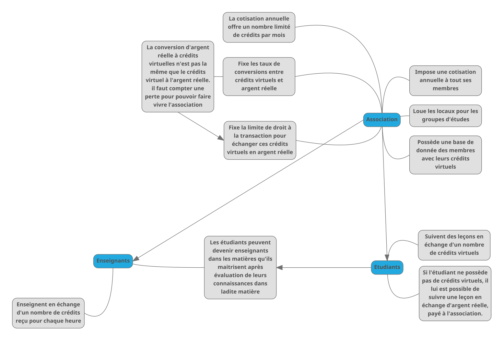
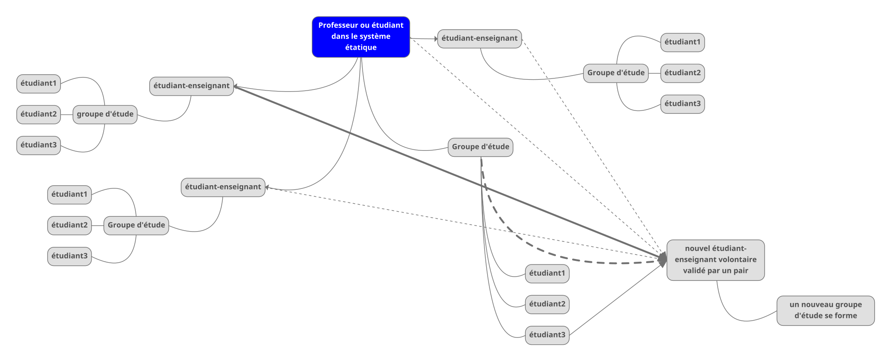
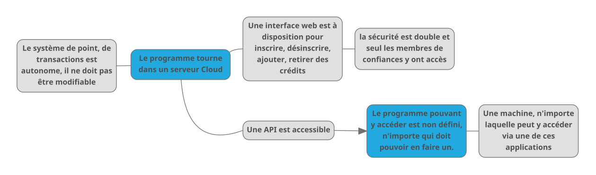
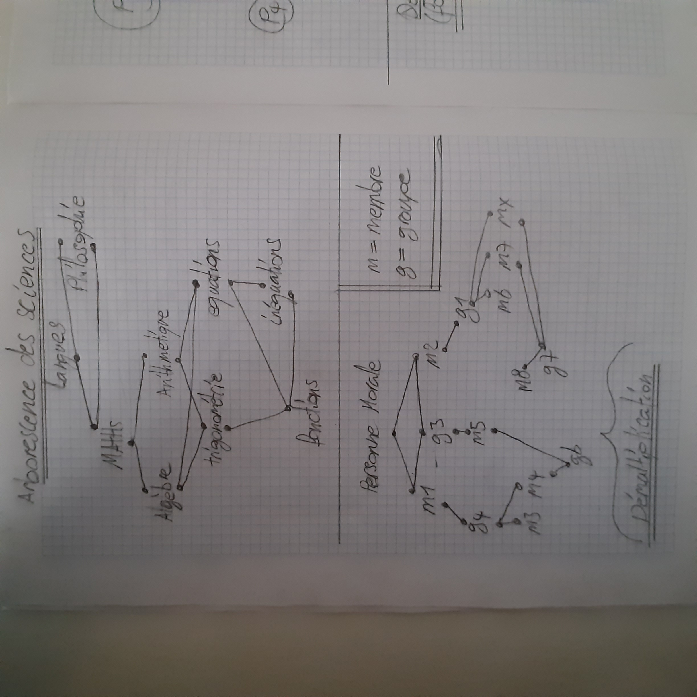
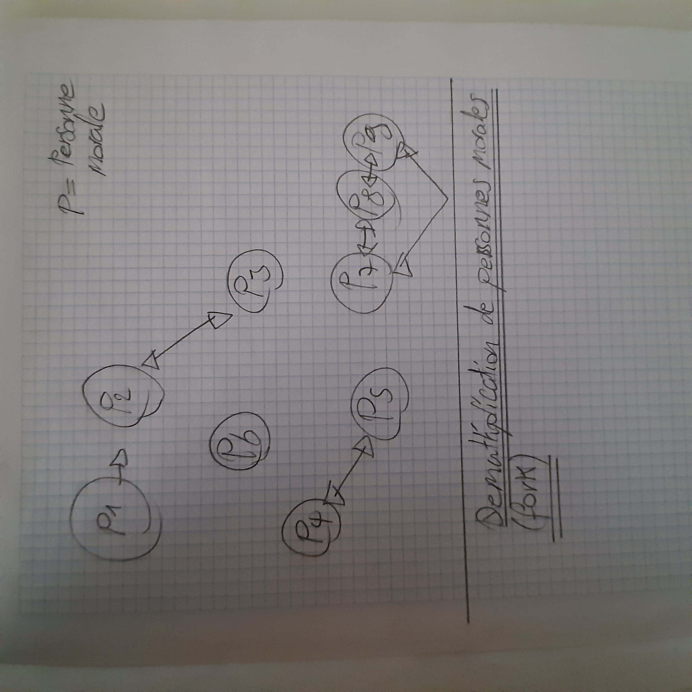

# Schémas numériques

## Fonctionnement du système de crédits

## Fonctionnement de la démultiplication des enseignants

## Fonctionnement général du réseau informatique

    Ceci est une possibilité, il peut y en avoir d'autres.

# Schémas manuscrits

